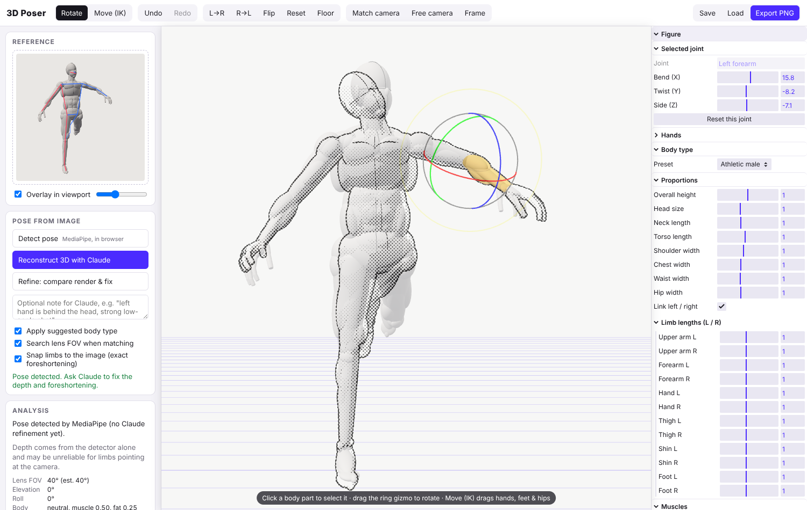

# 3D Poser

Turn a reference image (photo, sketch, manga panel, 3D render) into an editable, anatomical 3D
mannequin with matching pose, camera and foreshortening. Then adjust everything by hand: limb lengths,
muscle volume per body part, hands, lens, and render it as manga screentone, toon lines or clay.



## How it works

1. **Detect** (optional, in the browser): [MediaPipe Pose Landmarker](https://ai.google.dev/edge/mediapipe/solutions/vision/pose_landmarker)
   finds 2D/3D landmarks. Works well on photos, often fails on drawings.
2. **Reconstruct with Claude**: the image (plus the detector's landmarks, if any) goes to Claude, which
   returns structured JSON: 25 keypoints with image position *and* 3D camera-space position, lens FOV,
   camera elevation/roll, finger curl/spread per hand, and a body-type estimate. The prompt gives Claude
   anatomical bone-length priors so it can turn short-looking limbs into depth (foreshortening) and decide
   which way they point from overlap, size and perspective cues.
3. **Fit the camera**: the camera position is solved by least squares so the mannequin's joints project
   onto the image keypoints (the projection constraints are linear in the camera position), with a
   constrained search around Claude's lens estimate.
4. **Snap limbs to the image**: each bone keeps the mannequin's true length and its end joint is placed
   exactly on the camera ray through its image position. That leaves two answers (toward or away from
   the camera); Claude's 3D estimate picks one. This is what produces correct, strong foreshortening.
   Camera fit and snapping alternate a few times.
5. **Refine** (optional): the current mannequin is rendered from the matched camera and sent back to
   Claude next to the reference, with the keypoints that produced it. Claude compares them and returns
   corrected keypoints.

The pose solver retargets keypoint *directions* onto the rig (bend planes from elbows/knees, twist
shared between forearm and hand, automatic shoulder elevation when arms go overhead), so the figure
keeps its own proportions whatever the source.

## Editing

- **Click** any body part to select its joint. Drag the ring gizmo, or use the Bend/Twist/Side sliders.
- **Move (IK)** (`G`): drag hands and feet with two-bone IK; drag the hips and the feet stay planted.
- **Hands**: finger curl, thumb curl and spread per hand.
- **Body type**: presets (athletic, heroic, bodybuilder, slim, female, anime, heavy), proportions
  (height, head, neck, torso, shoulders, chest, waist, hips) and **limb lengths per side**.
- **Muscles**: neck, trapezius, deltoids, pectorals, lats, abs, obliques, biceps, triceps, forearms,
  glutes, quads, hamstrings, calves, plus body fat and breasts.
- **Camera & lens**: FOV with dolly zoom (keeps the subject's size while perspective changes),
  quick lens presets, *Match camera* to lock onto the reference with a semi-transparent overlay.
- **Render**: manga screentone, toon lines, sketch-on-blue, clay; construction lines on head and torso;
  line weight and screentone size.
- Mirror L→R / R→L, flip, undo/redo (`Ctrl+Z` / `Ctrl+Shift+Z`), snap to floor, save/load pose JSON,
  export PNG. The last state is kept in the browser.

## Running it

Requires Node 20+ and an Anthropic API key for the Claude steps (detection and editing work without one).

```bash
npm install
cp .env.example .env          # optional; or export the variable in your shell
export ANTHROPIC_API_KEY=sk-ant-...
npm run dev                   # API on :8787, app on http://localhost:5173
```

Production:

```bash
npm run build
npm start                     # serves dist/ and the API on :8787
```

If the server has no key, a key can be pasted in the app (*Claude API key*); it's stored only in that
browser and forwarded to your own server for the request.

| Variable | Default | |
| --- | --- | --- |
| `ANTHROPIC_API_KEY` | – | Used by the server for Claude requests. |
| `CLAUDE_MODEL` | `claude-opus-5-5` | Model for analysis. |
| `CLAUDE_EFFORT` | `high` | `low` / `medium` / `high` / `xhigh` / `max`. Higher is slower and more careful. |
| `PORT` | `8787` | API port (the Vite dev server proxies `/api` to it). |

The server uses structured outputs (the response is validated against `shared/schema.ts`), adaptive
thinking, streaming, and the API's server-side refusal fallback (`fallbacks: "default"`).

## Project layout

```
server/            Express API: /api/analyze (Claude), /api/health; serves dist/ in production
shared/schema.ts   Zod schema for Claude's structured output + request/response types
src/figure/        rig (joints, rest frames, mirror), anatomy (muscle volumes), params & presets,
                   solver (keypoints -> rotations, two-bone IK), lift (2D-exact foreshortening)
src/pose/          MediaPipe wrapper, keypoint conversions
src/render/        viewport (three.js, gizmos, IK effectors), toon/halftone styles, camera fitting
src/ui/gui.ts      lil-gui panels
```

## Notes and limits

- MediaPipe's model and WASM load from Google's and jsDelivr's CDNs on first detection.
- Depth from a single image is ambiguous; Claude resolves it from cues, and *Refine* and the gizmos are
  there for the rest. *Snap limbs to the image* can be turned off to keep Claude's 3D directions as-is.
- The mannequin is built from overlapping volumes, not a skinned scan, so extreme joint angles show
  seams. The hook for a heavier mesh-recovery model (e.g. SAM 3D Body running on a GPU server) is the
  same `PoseAnalysis` shape: anything that produces keypoints in this camera frame can drive the rig.
